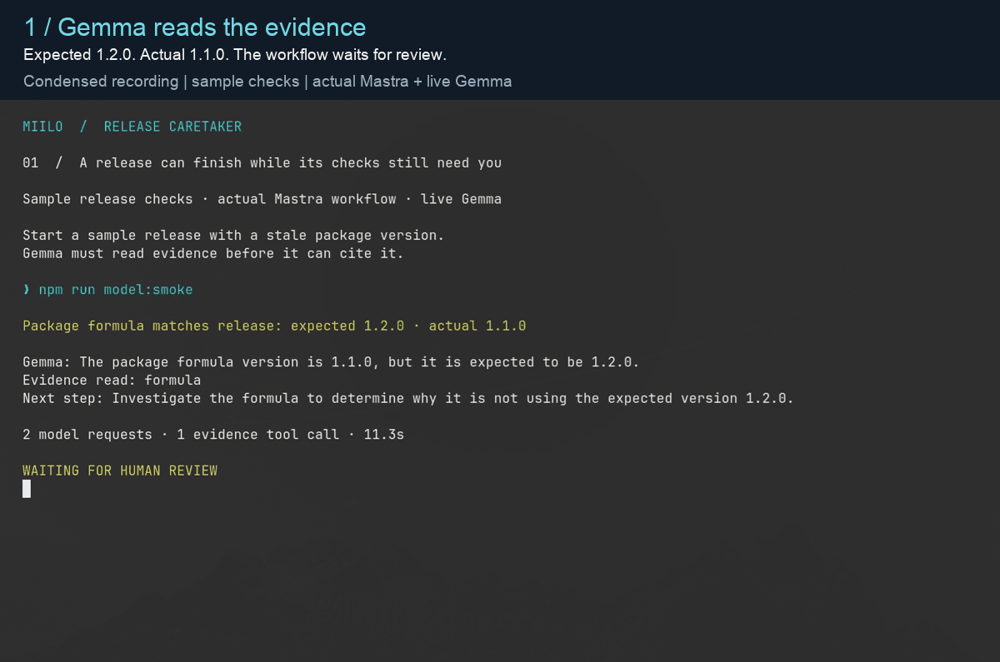

<h1 align="center">Miilo Release Caretaker</h1>
<p align="center">
  
  
  
</p>

Your release shipped. Can people actually use it?



[Watch the full silent recording](docs/media/caretaker-journey.mp4).
The 12-second GIF condenses three excerpts from the same 75-second recording;
captions describe actual output. Release checks use sample facts, with real Mastra
execution, live Gemma inference and the optional local Miilo integration.

Release Caretaker checks release evidence through a Mastra workflow. The current
local prototype runs labeled sample scenarios, parallel checks, bounded retries,
SQLite checkpoints and revision-bound human review. An optional
[local Miilo integration](integration/miilo/README.md) exports selected workflow
observations for the matching local SDK and CLI. An optional configurable Mastra
Agent investigates evidence using a compatible model endpoint. It does not yet
query GitHub, install packages or serve a website.

## Run locally

Requires Node.js 22.13 or later and npm. Linux and macOS are the tested platforms.

```sh
npm ci --ignore-scripts
npm run check
npm test
npm run demo -- healthy
npm run demo -- stale-package
npm run demo -- broken-release
```

Exit codes: `0` for passed checks, `1` for findings or inconclusive checks,
`2` for invalid input or a workflow failure. A Mastra run can finish successfully
while its release checks report problems. These are separate outcomes.

The sample adapter performs no network requests or process execution. The domain
evaluates provided facts; framework and future I/O implementations belong in
adapters. No model is allowed to overwrite a check verdict.

## Persisted review journey

```sh
npm run journey -- start stale-package
```

The result includes a run ID, a report revision and `suspended` status. Exit the
process, inspect the persisted state, then resume using those exact values:

```sh
npm run journey -- status RUN_ID
npm run journey -- resume RUN_ID REVISION recheck --sample-repaired
```

`--sample-repaired` makes the verification read healthy sample facts. It does not
fix a real release or modify a repository. Without it, rechecking the same broken
sample still reports failed checks. `acknowledge` records review without rechecking
or changing the verdict. A stale revision remains suspended; a completed run cannot
be resumed. These are read-only review decisions, not authorization to publish fixes.

Local run snapshots live in `.caretaker/runs.db`, excluded from Git, with owner-only
permissions on newly created state. Override the directory using
`CARETAKER_STATE_DIR`. Snapshots currently contain sample facts only. Do not enroll
private sources until redaction, retention and access controls are qualified.

Restart recovery is tested at saved human review and during a killed active
parallel read. Committed read results are reused; an unfinished read may repeat.
These tests do not establish exactly-once external writes or power-loss durability.

See [model investigation](docs/model-investigation.md) for private endpoint/model
configuration, scoped evidence tools and explicit live-inference testing. Ordinary
tests use disposable model servers and never call a configured live endpoint.

For an isolated terminal recording of the actual local workflow and CLI bridge,
follow [the showcase instructions](docs/recorded-demo.md).

See [.specify/specs/release-caretaker/spec.md](.specify/specs/release-caretaker/spec.md)
for acceptance criteria and the implementation sequence. Hosting is deferred until
local integration and failure recovery are validated.

Known dependency advisories and hosting restrictions are documented in
[dependency qualification](.specify/specs/release-caretaker/dependencies.md).
